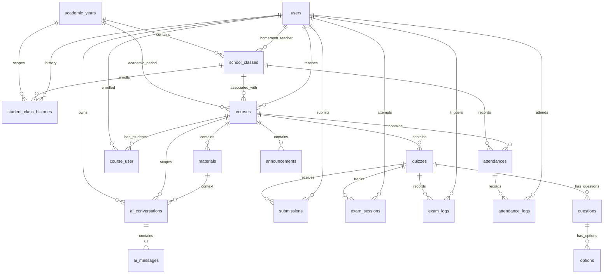

# Product Requirement Document (PRD) — LMS EDUVA

> **Versi Dokumen:** 4.0 (Pengawasan Ujian dan Akademik Terpadu)
> **Status Proyek:** Teruji lokal: 106 tes PHP (636 assertions), 2 skenario browser; validasi perangkat SEB dan beban produksi tetap diperlukan.
> **Target Pengguna:** Administrator Institusi, Tenaga Pengajar (Guru), Siswa (Murid)  
> **Stack Utama:** Laravel 12 (PHP 8.2+), Blade, Tailwind CSS, Alpine.js, Vite, Google Gemini API, Native Excel/Document Services

---

## 1. Pendahuluan & Visi Produk

### 1.1 Latar Belakang & Visi
**EDUVA** adalah sistem manajemen pembelajaran (*Learning Management System* / LMS) modern, terintegrasi, dan berbasis kecerdasan buatan (*AI-powered*) yang dirancang khusus untuk institusi pendidikan (sekolah menengah dan perguruan tinggi). 

Visi utama EDUVA adalah menghadirkan sistem akademik yang berorientasi pada kemudahan guru dan fokus belajar siswa dengan antarmuka yang bersih, fungsional, dan menolak ornamen visual berlebihan (*anti-AI slop*).

Sistem ini mengintegrasikan dua pilar utama pendidikan:
1. **Pilar Manajerial Akademik (Administrator):** Pengelolaan tahun ajaran berkesinambungan, rombongan belajar (rombel kelas), penempatan dan mutasi siswa antar-kelas dengan pencatatan riwayat transparan, integrasi import massal data pengguna sekaligus rombel, serta monitoring kesehatan akademik institusi.
2. **Pilar Pembelajaran & Rekapitulasi (Guru & Siswa):** Pengelolaan mata pelajaran dan alur pertemuan, generator soal otomatis via AI (Google Gemini), evaluasi daring berpengawas anti-cheat (*tab-switch monitoring*), presensi terpadu dengan matriks kehadiran (P1..Pn), kalkulasi nilai akhir berbobot transparan, rekap pengumpulan tugas, analisis sebaran nilai ujian, laporan rapor akademik 360° per siswa, ekspor dokumen resmi (.xlsx native & PDF print), pendampingan belajar mandiri via **AI Tutor**, serta modul keamanan ganti kata sandi mandiri.

### 1.2 Tujuan Dokumen
Dokumen PRD ini disusun sebagai acuan teknis, spesifikasi fungsional, dan arsitektural resmi bagi developer, pengembang lanjutan, atau auditor sistem agar dapat memahami struktur kode, relasi database, logika bisnis, hak akses peran (RBAC), serta melanjutkan pengembangan fitur tanpa merusak fungsionalitas yang telah berjalan.

---

## 2. Arsitektur Sistem & Spesifikasi Teknologi

```
+----------------------------------------------------------------------------------+
|                                  CLIENT BROWSER                                  |
|        (Blade Views + Alpine.js Reactive State + Tailwind CSS + Vite Assets)     |
+----------------------------------------+-----------------------------------------+
                                         | HTTP / HTTPS / AJAX / JSON API
                                         v
+----------------------------------------------------------------------------------+
|                             LARAVEL 12 BACKEND CORE                              |
|  - Routing & Middleware (Auth, Role-Based Access Control, Supervisory Redirect)  |
|  - Controllers:                                                                  |
|      * Admin (Users, Classes, Placement, Academic Years, Import, Security, Logs) |
|      * Teacher (Courses, Meetings, Quizzes, Attendance, Grades, Reports, Exams)  |
|      * Student (Dashboard, Learning Outline, Quiz Attempt, AI Tutor)             |
|      * Shared (Profile, Change Password, Authentication)                         |
|  - Domain Services:                                                              |
|      * ExcelService (Native OpenXML/Zip Spreadsheet Generator & CSV Parser)      |
|      * GeminiService (Google Gemini API with multi-model fallback)               |
|      * AiQuestionGeneratorService & WordQuestionService                          |
|      * DocumentTextExtractor (PDF, DOCX, PPTX, TXT)                              |
|  - Eloquent ORM + Database Transactions                                          |
+--------------------+---------------------------+-------------------+-------------+
                     |                           |                   |
                     v                           v                   v
             +---------------+           +---------------+   +-------------------+
             | SQLite/MySQL  |           | Public Disk   |   | Google Gemini API |
             | Database Core |           | File Storage  |   | (LLM Engine)      |
             +---------------+           +---------------+   +-------------------+
```

### 2.1 Spesifikasi Stack Teknologi
- **Backend:** PHP `^8.2`, Laravel `^12.0` (Breeze Authentication, Eloquent ORM, Database Transactions).
- **Frontend:** Laravel Blade Templating, Alpine.js `^3.4.2` (deklaratif, modal state, dynamic forms, live criteria indicators), Tailwind CSS `^3.1.0` (utility styling & typography tokens), Vite `^7.0.7`.
- **Manipulasi & Parsing Spreadsheet/Dokumen:**
  - `App\Services\ExcelService`: Pembangkit file `.xlsx` berbasis XML/Zip native berkinerja tinggi tanpa dependensi library berat, serta pembaca format `.csv` & `.xlsx`.
  - `smalot/pdfparser`: Ekstraksi teks dokumen PDF untuk bahan soal AI.
  - `phpoffice/phpword` `1.3`: Parser soal berbasis berkas template Microsoft Word (.docx).
  - Native ZIP / XML Parser PHP: Ekstraksi teks presentasi Microsoft PowerPoint (.pptx).
- **Layanan Kecerdasan Buatan (AI):** Google Gemini API (`gemini-flash-lite-latest`, `gemini-3.1-flash-lite-preview`, `gemini-flash-latest`, `gemini-3-flash-preview`) dengan sistem *graceful model fallback*.
- **Penyimpanan:** Local Disk Storage (`storage/app/public` terhubung via symlink ke `public/storage`).
- **Database:** SQLite (development/testing) atau MySQL/MariaDB/PostgreSQL (production).
- **Pengujian Mutu (QA):** PHPUnit `^11.5` dengan 91 automated feature tests (531 assertions) lulus 100%.

---

## 3. Peran Pengguna & Hak Akses (User Roles & RBAC)

Sistem membagi pengguna ke dalam 3 peran (*role*) terisolasi:

| Modul / Kemampuan Sistem | Administrator (`admin`) | Guru (`guru`) | Siswa (`siswa`) |
| :--- | :---: | :---: | :---: |
| **Pusat Administrator (Users, Security, Logs, Settings)** | Penuh | Ditolak (403) | Ditolak (403) |
| **Manajemen Tahun Ajaran & Rombel Kelas Sekolah** | Penuh | Ditolak (403) | Ditolak (403) |
| **Penempatan & Mutasi Siswa Antar-Kelas** | Penuh | Ditolak (403) | Ditolak (403) |
| **Monitoring Akademik Global Sekolah** | Penuh | Ditolak (403) | Ditolak (403) |
| **Import Massal Pengguna + Penempatan Kelas** | Penuh | Ditolak (403) | Ditolak (403) |
| **Supervisi Mata Pelajaran (`/kelas/{id}`)** | Dialihkan ke Supervisi | Penuh (Milik Sendiri) | Hanya Ikuti |
| **Buat / Edit / Hapus Mata Pelajaran (Course)** | Supervisi | Penuh | Ditolak (403) |
| **Kelola Pertemuan & Tambah Aktivitas Pembelajaran** | Supervisi | Penuh | Hanya Membaca |
| **Hapus Pertemuan Beserta Seluruh Konten Terkait** | Supervisi | Penuh | Ditolak (403) |
| **Absensi Terpadu, Roll-Call, & Matriks Rekap P1..Pn** | Supervisi | Penuh | Hanya Isi Presensi |
| **Buku Rekap Nilai Siswa (Bobot Tugas + Ujian Transparan)**| Supervisi | Penuh | Ditolak (403) |
| **Rekap Tugas & Penilaian Hasil Kerja Siswa** | Supervisi | Penuh | Hanya Mengumpulkan |
| **Rekap Hasil Ujian & Sebaran Predikat (A–E)** | Supervisi | Penuh | Ditolak (403) |
| **Laporan Profil 360° Perkembangan Akademik Siswa** | Supervisi | Penuh | Ditolak (403) |
| **Ekspor Dokumen Resmi (.xlsx Native & PDF Print)** | Ya | Ya | Ditolak (403) |
| **AI Question Generator & Import Soal Word** | Supervisi | Penuh | Ditolak (403) |
| **Kerjakan Ujian Daring (Pengawasan Anti-Cheat)** | Ditolak | Ditolak | Ya |
| **AI Tutor Interaktif Berkonteks Pertemuan** | Ditolak (Guard) | Ditolak (Guard) | Ya (Kelas Sendiri) |
| **Ganti Kata Sandi Mandiri (`/ganti-password`)** | Ya | Ya | Ya |

### 3.1 Kredensial Default (Seeder Awal)
Database seeder (`php artisan db:seed`) menyiapkan akun standar:
- **Admin:** `admin` / Password: `password` (Email: `admin@eduva.com`)
- **Guru:** `198501012010011001` / Password: `password` (Email: `guru@eduva.com`)
- **Siswa:** `202401001` / Password: `password` (Email: `siswa@eduva.com`)
- **Password Default Akun Baru / Reset Admin:** `eduva123@`

---

## 4. Modul Fungsional Utama

### 4.1 Manajemen Autentikasi, Keamanan Akun & Fitur Ganti Password
- **Multi-Identifier Login:** Pengguna dapat masuk menggunakan Nomor Identitas (`identity_number`: NIP untuk Guru, NIM untuk Siswa, atau username `admin`) maupun alamat email resmi.
- **Halaman Khusus Ganti Password (`/ganti-password`):**
  - Tampilan fokus, modern, dan bebas distraksi ([change-password.blade.php](file:///e:/pemrogramman%20web%202/eduva/resources/views/auth/change-password.blade.php)).
  - Ringkasan profil akun: Nama, Peranan, NIP/NIM, dan Status Password.
  - Fitur toggle intip kata sandi (*show/hide eye icon*) di setiap field input password lama, baru, dan konfirmasi.
  - Indikator kecukupan karakter (minimal 8 karakter) dan kecocokan konfirmasi secara real-time via Alpine.js.
  - Validasi aman: Memastikan password lama sesuai, password baru minimal 8 karakter, dan konfirmasi cocok.
  - Otomatis mengubah flag `must_change_password` menjadi `false`.
  - Rekam jejak audit keamanan dicatat ke `activity_logs` dengan aksi `auth.password_change`.
- **Peringatan Password Sementara:**
  - Banner peringatan dinamis pada Dashboard Guru dan Siswa jika akun terdeteksi masih menggunakan kata sandi default sistem (`eduva123@`).
  - Shortcut langsung *Ganti Password* pada navigasi sidebar (section *Akun Saya*), tombol kartu profil pojok kiri bawah, dan kartu *Aksi Cepat* pada dashboard.

---

### 4.2 Pusat Administrator (Admin Management Center)
Akses rute di bawah prefix `/admin`:
1. **Admin Dashboard (`/admin/dashboard`):** Metrik ringkasan jumlah siswa, guru, kelas, pertumbuhan akun, status kesehatan keamanan, dan log peristiwa terkini.
2. **Manajemen Pengguna (`/admin/users`):** Tambah akun, edit profil, toggle aktivasi akun, reset password ke default `eduva123@`, dan hapus pengguna dengan proteksi akun admin mandiri.
3. **Import Pengguna Massal (`/admin/users/import`):**
   - Mendukung format Excel (.xlsx) dan CSV dengan template standar resmi institusi.
   - Kolom opsional `kelas` (contoh: `12 IPA A`). Jika diisi dan terdaftar di database, sistem secara otomatis menempatkan siswa ke rombel tersebut dalam transaksi database yang aman.
   - Pratinjau (*preview*) data dan deteksi error validasi sebelum disimpan permanen ke database.
4. **Monitoring Mata Pelajaran (`/admin/courses`):** Pengawasan seluruh mata pelajaran yang diampu guru, daftar siswa terdaftar, materi, dan toggle status aktif.
5. **Keamanan Akun & Log Aktivitas (`/admin/security` & `/admin/logs`):** Pelacakan IP address, agen peramban, riwayat aksi administratif, serta tombol cepat reset kredensial.
6. **Pengaturan Sistem (`/admin/settings`):** Konfigurasi global nama institusi, kebijakan pendaftaran, dan semester aktif.

---

### 4.3 Manajemen Akademik Administrator
Akses rute di bawah prefix `/admin/academic`:
1. **Pengelolaan Tahun Ajaran (`/admin/academic/years`):**
   - Tambah, edit, aktifkan, dan arsipkan tahun ajaran (contoh: `2026/2027 Ganjil`).
   - Mekanisme satu tahun ajaran aktif: Mengaktifkan satu tahun ajaran otomatis menonaktifkan tahun ajaran sebelumnya.
   - Proteksi penghapusan: Tahun ajaran yang telah memiliki kelas rombel tidak dapat dihapus sembarangan.
2. **Manajemen Kelas Rombel (`/admin/academic/classes`):**
   - Pembuatan rombel sekolah (contoh: `12 IPA A`, `12 IPA C`, `10 IPS A`) dengan penentuan tingkat (10/11/12), jurusan (MIPA/IPS/Bahasa/Umum), tahun ajaran, dan penunjukan wali kelas (*homeroom teacher*).
   - Halaman detail kelas (`show.blade.php`): Menampilkan daftar siswa aktif, jumlah siswa, mata pelajaran yang terhubung, dan riwayat mutasi.
   - Fitur **Tambahkan Siswa**: Menampilkan daftar siswa yang belum memiliki rombel aktif pada tahun ajaran terkait untuk ditambahkan secara massal.
   - Fitur **Pindahkan Siswa (Mutasi Kelas)**: Memindahkan siswa ke kelas tujuan dengan mencatat status lama sebagai `moved` beserta tanggal mutasi dan catatan alasan pemindahan tanpa menghapus riwayat akademik nilai siswa.
   - Fitur **Keluarkan Siswa**: Mengeluarkan siswa dari rombel tanpa menghapus akun pengguna dari database.
3. **Daftar Penempatan Siswa (`/admin/academic/students`):**
   - Pemantauan menyeluruh status penempatan seluruh siswa sekolah.
   - Filter cepat: Menampilkan siswa yang sudah memiliki kelas vs siswa yang belum memiliki kelas.
4. **Monitoring Akademik Global (`/admin/academic/monitoring`):**
   - Metrik statistik makro: Rerata persentase presensi seluruh sekolah, tingkat penyelesaian tugas, total sesi ujian, dan sebaran rombel.

---

### 4.4 Manajemen Kelas & Alur Pertemuan Pembelajaran (Course Outline)
- **Struktur Berbasis Topik / Pertemuan:** Setiap materi, kuis, tugas, dan presensi dikelompokkan ke dalam satu string `topic` (contoh: *Pertemuan 01 — Pengantar Fisika Kuantum*).
- **Accordion Alur Pembelajaran Persisten:**
  - Tiap pertemuan dapat dibuka-tutup secara independen.
  - Tombol tunggal *Buka Semua / Tutup Semua* dengan status tersimpan di `localStorage` per pengguna per kelas.
- **Penghapusan Pertemuan Aman:**
  - Guru dapat menghapus keseluruhan pertemuan melalui modal konfirmasi `delete-meeting-modal`.
  - Sistem menghapus seluruh aktivitas di dalam pertemuan tersebut secara transaksional (`Material`, `Quiz`, `Attendance`, `Announcement`) serta menghapus berkas fisik di storage.

---

### 4.5 Modal Tambah Aktivitas Terpadu (Unified Modal)
Modal modern dengan komposisi 3 bagian (Header, Content scrollable, Sticky Footer):
1. **Selector 7 Jenis Aktivitas:** `label`, `file`, `page`, `video`, `quiz`, `assignment`, dan `attendance`.
2. **Searchable Dropdown Pertemuan Riil:**
   - Menampilkan daftar pertemuan riil yang sudah ada di database kelas.
   - Fitur pencarian cepat dan opsi membuat pertemuan baru langsung.
   - Jika modal dibuka dari tombol pertemuan tertentu, nilai pertemuan otomatis terkunci (*auto-context locked*).
3. **Date & Time Picker Standar Indonesia (`DD/MM/YYYY` + `HH:MM`):**
   - Antarmuka kalender popover Alpine.js dengan validasi logis (waktu selesai tidak boleh lebih awal dari waktu mulai).

---

### 4.6 Rekapitulasi Akademik Guru
Akses rute di bawah prefix `/academic`:
1. **Absensi & Presensi Siswa (`/academic/attendance`):**
   - Pembuatan sesi presensi pertemuan dengan opsi *auto-populate* kehadiran default.
   - Formulir roll-call interaktif: Radio button status Hadir, Izin, Sakit, Alpa (H/I/S/A) per siswa disertai catatan keterangan guru.
   - **Matriks Rekapitulasi Kehadiran (`/academic/attendance/recap`):** Menampilkan tabel matriks seluruh pertemuan (P1, P2.. Pn), akumulasi H/I/S/A, serta persentase kehadiran otomatis.
   - Unduhan format Excel native (`.xlsx`) dan format cetak resmi / PDF print.
2. **Rekapitulasi Nilai Siswa (`/academic/grades`):**
   - Agregasi nilai rata-rata tugas (`quizzes` tipe `assignment`) dan ujian (`quizzes` tipe `quiz`).
   - **Konfigurasi Bobot Penilaian Transparan:** Guru dapat menyesuaikan persentase bobot penilaian langsung di halaman (default: 40% Tugas + 60% Ujian).
   - Perhitungan Nilai Akhir otomatis beserta konversi Predikat Akademik:
     - **A:** $\ge 85$
     - **B:** $75 - 84.9$
     - **C:** $65 - 74.9$
     - **D:** $50 - 64.9$
     - **E:** $< 50$
   - Fitur update nilai dan feedback langsung dari guru.
   - Ekspor Excel (.xlsx) dan Cetak Rapor Nilai / PDF print.
3. **Rekapitulasi Tugas Pembelajaran (`/academic/assignments`):**
   - Pemantauan status pengerjaan: Belum Mengumpulkan, Sudah Mengumpulkan, Terlambat, dan Sudah Dinilai.
   - Rekap nilai tugas dan umpan balik guru. Ekspor XLSX & Cetak PDF.
4. **Rekapitulasi & Sebaran Ujian (`/academic/exams`):**
   - Analisis statistik evaluasi: Nilai tertinggi, nilai terendah, nilai rata-rata kelas.
   - Grafik distribusi predikat siswa (A, B, C, D, E) untuk evaluasi mutu butir soal. Ekspor XLSX & Cetak PDF.
5. **Laporan Perkembangan Profil Akademik 360° Siswa (`/academic/reports`):**
   - Daftar rekam jejak akademik siswa per kelas mata pelajaran.
   - **Profil Akademik Individual (`/academic/reports/student/{id}`):** Lembar komprehensif 360° satu siswa yang menggabungkan rekap kehadiran, daftar seluruh tugas yang dikumpulkan, daftar hasil ujian, dan predikat akhir siswa.

---

### 4.7 Kuis, Evaluasi Daring & Pengawasan Anti-Cheating
- **Server Timer Synchronization:** Durasi ujian (jam & menit) disinkronkan dengan jam server melalui tabel `exam_sessions`. Refresh halaman tidak mereset waktu pengerjaan.
- **Otomatis Submit (Auto-Submit):** Saat waktu berakhir, sistem otomatis mengumpulkan jawaban siswa dan menandai sesi sebagai `time_out`.
- **Deteksi Kecurangan Berpindah Tab (`detect_tab_switch`):**
  - Pemantauan event `visibilitychange` dan `blur` pada browser siswa.
  - Setiap kali siswa meninggalkan tab kuis, log pelanggaran dicatat ke tabel `exam_logs` via AJAX.

---

### 4.8 Pembuatan Soal Word & AI Question Generator
1. **Impor Soal Microsoft Word (.docx):** Ekstraksi soal pilihan ganda dan esai via template Word resmi menggunakan `WordQuestionService` dengan pratinjau sebelum simpan.
2. **AI Question Generator (Google Gemini):**
   - Unggah materi dalam format `.pdf`, `.doc`, `.docx`, `.ppt`, `.pptx`, dan `.txt`.
   - Pembersihan teks pembelajaran via `DocumentTextExtractor`.
   - Generator soal pilihan ganda atau esai dengan pengaturan jumlah soal (1–20) dan tingkat kesulitan (Mudah, Sedang, Sulit, Campuran).
   - Pratinjau interaktif: Guru dapat mengedit soal hasil AI, menghapus soal tertentu, atau meregenerasi butir soal spesifik sebelum disimpan ke bank soal kuis.

---

### 4.9 Asisten Pembelajaran Cerdas (AI Tutor)
Asisten tutor interaktif khusus siswa bertenaga Google Gemini:
- **Konteks Materi Ketat:** Siswa hanya dapat berinteraksi dengan materi pertemuan dari kelas yang diikutinya secara aktif.
- **5 Mode Belajar Interaktif:** *Tanya Jawab Bebas*, *Penjelasan Sederhana (Analogi)*, *Ringkasan Materi*, *Latihan Soal Interaktif (soal diberikan satu per satu)*, dan *Persiapan Ujian*.
- **UI Chat Modern:** Highlight sintaks kode pemrograman via `highlight.js`, sanitasi HTML aman via `DOMPurify`, pratinjau kode live dalam iframe terisolasi, bubble chat proporsional, dan penyesuaian skala mobile/tablet yang nyaman.

---

## 5. Skema Basis Data & Entitas Relasi (Database Schema)



### 5.1 Rincian Kamus Data Entitas
1. **`users`:** `id`, `name`, `email`, `identity_number` (NIP/NIM/username), `password`, `role` (`admin`|`guru`|`siswa`), `must_change_password`, `is_active`.
2. **`academic_years`:** `id`, `name` (misal `2026/2027`), `semester` (`Ganjil`|`Genap`), `is_active`, `start_date`, `end_date`, `status` (`active`|`archived`|`upcoming`).
3. **`school_classes`:** `id`, `academic_year_id`, `name` (misal `12 IPA A`), `level` (`10`|`11`|`12`), `department` (`MIPA`|`IPS`|`Umum`), `homeroom_teacher_id` (FK `users`), `status` (`active`|`archived`).
4. **`student_class_histories`:** `id`, `user_id`, `school_class_id`, `academic_year_id`, `status` (`active`|`moved`|`graduated`), `assigned_at`, `moved_at`, `notes`.
5. **`teacher_class_assignments`:** `id`, `teacher_id`, `school_class_id`, `course_id`, `academic_year_id`, `role_title`.
6. **`courses`:** `id`, `teacher_id`, `school_class_id`, `academic_year_id`, `title`, `description`, `invitation_code`, `status`, `color`.
7. **`course_user`:** `course_id`, `user_id` (Pivot pendaftaran siswa ke mata pelajaran).
8. **`materials`:** `id`, `course_id`, `topic`, `type` (`file`|`page`|`video`|`label`), `title`, `content`, `file_path`, `video_url`, `order`, `is_visible`.
9. **`quizzes`:** `id`, `course_id`, `topic`, `title`, `description`, `type` (`quiz`|`assignment`), `duration` (menit), `start_time`, `deadline`, `detect_tab_switch`, `order`, `is_visible`.
10. **`questions`:** `id`, `quiz_id`, `question_text`, `type` (`multiple_choice`|`essay`), `points`, `order`, `explanation`.
11. **`options`:** `id`, `question_id`, `option_text`, `is_correct`.
12. **`submissions`:** `id`, `quiz_id`, `user_id`, `file_path`, `score`, `feedback`, `answers` (JSON jawaban kuis).
13. **`exam_sessions`:** `id`, `quiz_id`, `user_id`, `started_at`, `expires_at`, `submitted_at`, `status` (`in_progress`|`submitted`|`time_out`).
14. **`exam_logs`:** `id`, `quiz_id`, `user_id`, `event_type` (`tab_switch`|`window_blur`), `description`, `timestamp`.
15. **`attendances`:** `id`, `course_id`, `school_class_id`, `topic`, `title`, `description`, `start_time`, `end_time`, `is_active`, `is_visible`.
16. **`attendance_logs`:** `id`, `attendance_id`, `user_id`, `status` (`hadir`|`izin`|`sakit`|`alpa`), `note`.
17. **`announcements`:** `id`, `course_id`, `user_id`, `topic`, `content`.
18. **`ai_conversations`:** `id`, `user_id`, `course_id`, `material_id`, `title`, `study_mode`, `difficulty`.
19. **`ai_messages`:** `id`, `conversation_id`, `role` (`user`|`assistant`|`system`), `content`, `sources` (JSON).
20. **`activity_logs`:** `id`, `user_id`, `action`, `description`, `ip_address`, `user_agent`.
21. **`system_settings`:** `id`, `key`, `value`, `type`, `description`.

---

## 6. Standar Desain UI/UX & Design Tokens

Sesuai aturan utama **"desainnya sebisa mungkin jangan AI SLOP"**, EDUVA menerapkan tata desain profesional, bersih, elegan, dan fungsional:

### 6.1 Palet Warna Resmi
```css
:root {
  --eduva-bg-page: #F5F8FC;        /* Latar belakang kanvas aplikasi */
  --eduva-bg-card: #FFFFFF;        /* Latar kartu, tabel & modal */
  --eduva-border: #E5EAF0;         /* Garis pemisah netral lembut */
  --eduva-border-input: #D7DFE9;   /* Garis tepi field input */

  --eduva-text-main: #263445;      /* Teks judul & label utama */
  --eduva-text-secondary: #718096; /* Teks petunjuk & keterangan sekunder */

  --eduva-primary: #438FCE;        /* Aksen biru primer EDUVA */
  --eduva-primary-hover: #357ebd;  /* Hover interaksi primer */
  --eduva-primary-light: #DFEAF9;  /* Badge konteks & indikator aktif */
  --eduva-primary-dark: #2E6C9E;   /* Teks kontras tinggi aksen biru */

  --eduva-success: #10B981;        /* Hadir / Nilai Baik / Sukses */
  --eduva-warning: #F59E0B;        /* Izin / Perlu Perhatian / Pending */
  --eduva-danger: #EF4444;         /* Alpa / Error / Tombol Hapus */
}
```

### 6.2 Kaidah Komponen UI
- **Input Field:** Tinggi konsisten `44px` hingga `48px`, border tipis `#D7DFE9`, latar netral, border-radius `10px`–`12px`, focus ring `#438FCE/20`.
- **Textarea:** Tinggi awal `110px`–`130px`, mendukung pengetikan instruksi panjang dengan scroll internal yang nyaman.
- **Badge & Pill:** Huruf kapital berukuran `10px`–`11px`, font-bold, background pastel dengan border tipis bertema sama.
- **Modal:** Header bergaris pemisah, area konten scrollable, dan sticky footer dengan tombol aksi rata kanan.
- **Layout Responsif:** Pada layar desktop menggunakan tata letak multi-kolom; otomatis menjadi satu kolom vertikal proporsional pada tablet dan smartphone tanpa *horizontal overflow*.

---


## 7. Struktur Direktori Proyek

```
eduva/
├── app/
│   ├── Http/
│   │   ├── Controllers/
│   │   │   ├── AdminAcademicMonitoringController.php  # Monitoring statistik makro institusi
│   │   │   ├── AdminAcademicYearController.php        # Manajemen tahun ajaran & semester
│   │   │   ├── AdminSchoolClassController.php         # Manajemen rombel, mutasi & penempatan siswa
│   │   │   ├── AdminStudentPlacementController.php    # Roster status penempatan siswa
│   │   │   ├── AdminDashboardController.php           # Dashboard ringkasan administrator
│   │   │   ├── AdminUserController.php                # CRUD pengguna institusi
│   │   │   ├── AdminUserImportController.php          # Import massal Excel/CSV terintegrasi kelas
│   │   │   ├── AdminCourseController.php              # Pengawasan kelas mata pelajaran
│   │   │   ├── AdminSecurityController.php            # Pusat keamanan & reset akun
│   │   │   ├── AdminLogController.php                 # Audit log aktivitas sistem
│   │   │   ├── AdminSettingController.php             # Pengaturan konfigurasi sistem
│   │   │   ├── TeacherAttendanceController.php        # Absensi terpadu & matriks kehadiran
│   │   │   ├── TeacherGradeRecapController.php        # Rekap nilai berbobot transparan & predikat
│   │   │   ├── TeacherAssignmentRecapController.php   # Rekap pengumpulan tugas siswa
│   │   │   ├── TeacherExamRecapController.php         # Rekap statistik & sebaran ujian
│   │   │   ├── TeacherAcademicReportController.php    # Rapor profil perkembangan 360° siswa
│   │   │   ├── AiTutorController.php                  # Asisten belajar interaktif siswa
│   │   │   ├── Auth/PasswordController.php            # Modul ganti password mandiri
│   │   │   ├── CourseController.php                   # Mata pelajaran & supervisi admin
│   │   │   ├── MaterialController.php                 # Materi pembelajaran multi-tipe
│   │   │   ├── QuizController.php                     # Ujian daring & anti-cheat
│   │   │   ├── QuizAiGeneratorController.php          # Generator soal via AI Gemini
│   │   │   └── QuizImportController.php               # Parser soal template Word
│   ├── Models/
│   │   ├── AcademicYear.php                           # Model Tahun Ajaran
│   │   ├── SchoolClass.php                            # Model Kelas Rombel Sekolah
│   │   ├── StudentClassHistory.php                    # Model Riwayat Penempatan Siswa
│   │   ├── TeacherClassAssignment.php                 # Model Penugasan Guru
│   │   ├── User.php                                   # Model Pengguna (Admin, Guru, Siswa)
│   │   ├── Course.php                                 # Model Mata Pelajaran
│   │   ├── Material.php                               # Model Berkas & Halaman Materi
│   │   ├── Quiz.php                                   # Model Kuis & Penugasan
│   │   ├── Question.php & Option.php                  # Model Butir Soal & Kunci Jawaban
│   │   ├── Submission.php                             # Model Pengumpulan & Nilai Siswa
│   │   ├── Attendance.php & AttendanceLog.php         # Model Sesi & Presensi Siswa
│   │   └── ActivityLog.php                            # Model Rekam Jejak Sistem
│   └── Services/
│       ├── ExcelService.php                           # Generator XLSX native & parser CSV
│       ├── GeminiService.php                          # Klien integrasi Google Gemini AI
│       ├── AiQuestionGeneratorService.php             # Logika prompt & JSON soal AI
│       ├── DocumentTextExtractor.php                  # Ekstraktor teks dokumen multi-format
│       └── WordQuestionService.php                    # Ekstraktor soal Microsoft Word
├── database/
│   ├── migrations/                                    # Migrasi skema database
│   └── seeders/DatabaseSeeder.php                     # Seeder data pengguna & tahun ajaran default
├── resources/
│   └── views/
│       ├── admin/
│       │   ├── academic/                              # Tampilan tahun ajaran, rombel, penempatan, monitoring
│       │   ├── courses/                               # Monitoring mata pelajaran
│       │   ├── security/ & logs/                      # Audit keamanan & log aktivitas
│       │   └── users/                                 # Manajemen & import massal pengguna
│       ├── teacher/
│       │   └── academic/                              # Absensi, nilai, tugas, ujian, laporan 360
│       ├── auth/
│       │   └── change-password.blade.php              # Halaman ganti password mandiri
│       ├── ai-tutor/                                  # Antarmuka obrolan AI Tutor
│       ├── kelas/                                     # Outline pertemuan, alur accordion, modal aktivitas
│       ├── kuis/                                      # Pengerjaan kuis, anti-cheat, generator soal AI
│       └── layouts/                                   # Shell navigasi sidebar & header terpadu
├── routes/
│   ├── web.php                                        # Rute aplikasi utama
│   └── auth.php                                       # Rute otentikasi & ganti password
└── tests/Feature/                                     # 91 automated feature tests
```

---


## 8. Pengawasan Ujian: Browser Anti-Cheat dan Lockdown

### Dua level pengawasan

**Level 1 - Browser Anti-Cheat (cakupan EDUVA).** Pengawasan berjalan di browser tanpa instalasi aplikasi siswa. Sistem mencatat perpindahan tab atau perubahan visibilitas halaman, kehilangan dan kembalinya fokus, keluar dan masuk kembali ke fullscreen, serta interaksi ujian tertentu yang dapat dideteksi browser. Browser tidak dapat menjamin deteksi atau mencegah semua aktivitas di perangkat siswa; kejadian yang tercatat merupakan sinyal untuk ditinjau, bukan bukti otomatis kecurangan.

Setiap insiden menyimpan identitas siswa dan ujian, jenis kejadian, waktu kejadian, waktu kembali atau durasi kehilangan fokus bila tersedia, dan urutan kejadian. Catatan tampil sebagai **Incident Timeline** yang dapat ditinjau guru. **Live Monitoring Guru** memperbarui status peserta dan insiden sedekat mungkin dengan waktu nyata. Antarmuka harus menunjukkan status koneksi/pembaruan dan waktu insiden agar guru dapat membedakan data terbaru dari data tertunda.

**Violation Policy** dapat dikonfigurasi guru per ujian: jenis kejadian yang dicatat, tingkat peringatan, ambang pengulangan, serta tindakan ketika ambang tercapai. Kebijakan menjelaskan kepada siswa perilaku yang dipantau sebelum ujian dimulai. Insiden dan tindakan kebijakan dicatat untuk audit. Keputusan akademik tetap berada pada guru; sistem tidak otomatis menyimpulkan kecurangan hanya dari sinyal browser.

**Level 2 - Lockdown Exam Environment (integrasi opsional).** Untuk ujian resmi yang memerlukan pembatasan lingkungan perangkat, EDUVA dapat menyediakan panduan integrasi dengan Safe Exam Browser atau aplikasi ujian khusus. Pembatasan situs dan aplikasi bergantung pada perangkat, konfigurasi, dan kemampuan solusi yang dipakai, sehingga memerlukan persiapan perangkat siswa serta kebijakan sekolah. Level ini adalah integrasi terpisah dan tidak boleh diklaim sebagai kemampuan browser biasa.

### Rekomendasi implementasi

Prioritaskan implementasi Level 1 secara menyeluruh: Live Monitoring Guru, Incident Timeline, dan Violation Policy. Pertahankan pencatatan waktu, durasi kehilangan fokus hingga siswa kembali, serta pengulangan insiden agar guru dapat memahami konteks setiap peserta. Sediakan Level 2 sebagai opsi untuk ujian yang membutuhkan lingkungan perangkat terkunci, setelah persyaratan perangkat dan kebijakan institusi ditetapkan.

## 9. EDUVA v4.0 — Implementasi Pengawasan Ujian

Level 1 menyediakan monitoring browser aktif per sesi, korelasi blur/hidden, waktu kembali dan durasi, deteksi fullscreen/interaksi halaman, heartbeat, status koneksi, snapshot kebijakan, registrasi instance, pencegahan sesi bersamaan, autosave/recovery, auto-submit opsional pada ambang, review/false positive dengan audit, akomodasi siswa, pengakhiran oleh guru dan laporan CSV/XLSX/cetak PDF. Timer dan finalisasi ditentukan server. Pengiriman kejadian memakai UUID, validasi enrollment/ownership, CSRF dan rate limit; finalisasi menggunakan transaksi dan kunci sesi agar tidak dijalankan berulang.

Dashboard guru memakai polling terautentikasi dengan timeline incremental/paginasi dan SSE opsional pada deployment multi-worker. Timeout dan retensi bukti dijalankan lewat scheduler. Preset Standard mencatat tanpa penalti otomatis; Strict menambahkan fullscreen; Custom mengatur aturan tersendiri. Pengeditan kebijakan tidak mengubah sesi aktif. Pengecualian aksesibilitas dilakukan melalui akomodasi yang diaudit.

Level 2 disediakan sebagai integrasi gerbang Config Key request hash SEB, bukan klaim penguncian oleh situs. Distribusi konfigurasi/perangkat serta uji aplikasi SEB di sekolah tetap diperlukan. Dukungan header tidak mencakup otomatis seluruh modern WebView macOS/iOS. Browser biasa tidak dapat memastikan nama aplikasi lain, URL tab lain, proses OS, screenshot, atau aktivitas perangkat kedua. Kegagalan heartbeat bukan bukti kecurangan.

Panduan lengkap, keterbatasan, struktur komponen, deployment, retensi dan pengujian: [docs/exam-monitoring.md](docs/exam-monitoring.md).
