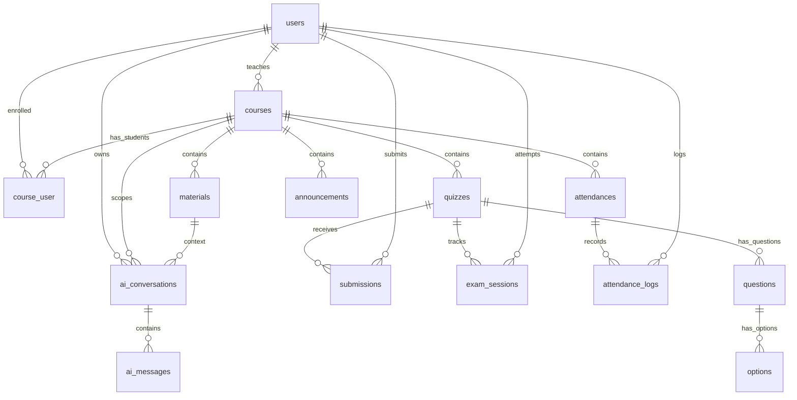

# Product Requirement Document (PRD) — LMS EDUVA

> **Versi Dokumen:** 2.0  
> **Status Proyek:** Aktif / Tahap Pengembangan Berkelanjutan  
> **Target Pengguna:** Administrator Institusi, Guru / Dosen, Siswa / Mahasiswa  
> **Stack Utama:** Laravel 12 (PHP 8.2+), Blade, Tailwind CSS, Alpine.js, Vite, Google Gemini API

---

## 1. Pendahuluan & Visi Produk

### 1.1 Latar Belakang & Visi
**EDUVA** adalah sistem manajemen pembelajaran (*Learning Management System* / LMS) modern, terintegrasi, dan berbasis kecerdasan buatan (*AI-powered*) yang dirancang untuk memberikan pengalaman belajar-mengajar yang bersih, efisien, dan fokus pada materi tanpa distraksi visual (*anti-AI slop*).

Sistem ini menggabungkan manajemen kelas terstruktur, evaluasi komprehensif (kuis dengan pengawasan anti-cheat dan penugasan mandiri), presensi otomatis, generator soal cerdas dari dokumen pembelajaran, serta **AI Tutor** yang mampu mendampingi siswa secara kontekstual sesuai materi dan pertemuan yang sedang dipelajari.

### 1.2 Tujuan Dokumen
Dokumen ini disusun sebagai panduan teknis, fungsional, dan arsitektural resmi agar developer atau tim pengembang baru dapat langsung memahami arsitektur, alur logika, relasi database, standar UI/UX, dan melanjutkan pengembangan fitur tanpa merusak fungsi yang sudah berjalan.

---

## 2. Arsitektur Sistem & Spesifikasi Teknologi

```
+--------------------------------------------------------------------------+
|                             CLIENT BROWSER                               |
|        (Blade Views + Alpine.js State + Tailwind CSS + Vite Assets)       |
+------------------------------------+-------------------------------------+
                                     | HTTP / AJAX / Fetch
                                     v
+--------------------------------------------------------------------------+
|                         LARAVEL 12 BACKEND CORE                          |
|  - Routing & Middleware (Auth, Role-Based Access Control)                |
|  - Controllers (Kelas, Materi, Kuis, Presensi, AI Tutor, Admin)          |
|  - Domain Services (DocumentTextExtractor, GeminiService, QuizGenerator) |
|  - Eloquent ORM + Database Transactions                                  |
+-------------------+--------------------+-------------------+-------------+
                    |                    |                   |
                    v                    v                   v
            +---------------+    +---------------+   +-------------------+
            | SQLite/MySQL  |    | Public Disk   |   | Google Gemini API |
            |  Database     |    | File Storage  |   | (LLM Engine)      |
            +---------------+    +---------------+   +-------------------+
```

### 2.1 Spesifikasi Stack Teknologi
- **Backend:** PHP `^8.2`, Laravel `^12.0` (Breeze Authentication, Eloquent ORM, DB Transactions).
- **Frontend:** Laravel Blade, Alpine.js `^3.4.2` (declarative UI & reactive state), Tailwind CSS `^3.1.0` (utility styling & typography tokens), Vite `^7.0.7`.
- **Parsing Dokumen:**
  - `smalot/pdfparser` (ekstraksi teks dokumen PDF).
  - `phpoffice/phpword` `1.3` (ekstraksi & pembacaan modul/dokumen DOCX).
  - Native ZIP / XML Parser bawaan PHP (ekstraksi teks slide PPTX & DOC).
- **Layanan AI:** Google Gemini API (`gemini-flash-lite-latest`, `gemini-3.1-flash-lite-preview`, `gemini-flash-latest`, `gemini-3-flash-preview`) dengan fallback model otomatis.
- **Penyimpanan:** Local Disk Storage (`storage/app/public` di-symlink ke `public/storage`).
- **Database:** SQLite (default development) atau MySQL/MariaDB/PostgreSQL (production-ready).
- **Pengujian:** PHPUnit `^11.5`, Laravel Feature & Unit Test Suite.

---

## 3. Peran Pengguna & Hak Akses (User Roles & RBAC)

Sistem menggunakan 3 peran (*roles*) dengan hak akses terisolasi:

| Modul / Fitur | Administrator (`admin`) | Guru (`guru`) | Siswa (`siswa`) |
| :--- | :---: | :---: | :---: |
| **Pusat Admin (Dashboard, User, Import, Audit Log, Settings)** | Full Access | Ditolak (403) | Ditolak (403) |
| **Buat / Edit / Hapus Kelas** | Ya | Ya (Milik Sendiri) | Ditolak (403) |
| **Gabung Kelas (Join via Kode) / Keluar Kelas** | Ditolak | Ditolak | Ya |
| **Kelola Pertemuan & Tambah Aktivitas** | Ya | Ya (Milik Sendiri) | Ditolak (403) |
| **Hapus Pertemuan Beserta Seluruh Aktivitas** | Ya | Ya (Milik Sendiri) | Ditolak (403) |
| **Unggah Berkas Materi / Halaman / Video** | Ya | Ya | Hanya Baca |
| **Buat Kuis, Soal, & AI Question Generator** | Ya | Ya | Ditolak (403) |
| **Kerjakan Ujian / Kuis Online (Anti-Cheat)** | Ditolak | Ditolak | Ya |
| **Kumpulkan Tugas (Assignment Submission)** | Ditolak | Ditolak | Ya |
| **Penilaian & Pemberian Nilai Tugas / Ujian** | Ya | Ya (Kelas Sendiri) | Ditolak (403) |
| **Buka / Tutup Sesi Presensi & Rekap Kehadiran** | Ya | Ya | Hanya Isi Presensi |
| **AI Tutor Interaktif Berkonteks** | Ditolak | Ditolak | Ya (Kelas yang Diikuti) |

### 3.1 Kredensial Default (Seeder Awal)
Data default saat menjalankan `php artisan db:seed`:
- **Admin:** `admin` / Password: `password` (Email: `admin@eduva.com`)
- **Guru:** `198501012010011001` / Password: `password` (Email: `guru@eduva.com`)
- **Siswa:** `202401001` / Password: `password` (Email: `siswa@eduva.com`)
- **Password Default Pengguna Baru / Reset:** `eduva123@`

---

## 4. Modul Fungsional Utama

### 4.1 Modul Autentikasi & Keamanan Akun
- **Multi-Identifier Login:** Pengguna dapat masuk menggunakan Nomor Identitas (`identity_number`: NIP untuk guru, NIM/NIS untuk siswa, atau username `admin`) maupun alamat email.
- **Kebijakan Ganti Password Pertama Kali:** Kolom `must_change_password` (boolean). Jika bernilai `true` (misal akun baru diimpor oleh admin), pengguna secara otomatis diarahkan ke halaman wajib ganti password sebelum dapat mengakses fitur lain.
- **Manajemen Sesi:** Proteksi CSRF pada semua request POST/PUT/DELETE, session expired otomatis setelah durasi inaktif.

---

### 4.2 Pusat Administrator (Admin Management Center)
Akses rute di bawah prefix `/admin`:
1. **Admin Dashboard:** Ringkasan total pengguna (siswa/guru), total kelas aktif, aktivitas harian, dan antrean koreksi.
2. **Manajemen Pengguna (`/admin/users`):** Tambah, edit, aktifkan/nonaktifkan akun, reset password ke default, dan hapus akun (dengan proteksi akun admin mandiri).
3. **Import Pengguna Massal (`/admin/users/import`):**
   - Mendukung format CSV dan Excel (.xlsx) dengan template resmi yang dapat diunduh.
   - Dilengkapi tahap **Preview & Validasi Data** sebelum commit ke database (mencegah duplikasi email / NIP / NIM).
4. **Monitoring Kelas (`/admin/courses`):** Pengawasan seluruh kelas, jumlah siswa, materi, dan toggle status aktif kelas.
5. **Pusat Keamanan & Audit Log (`/admin/security` & `/admin/logs`):** Pencatatan log aktivitas sistem (`ActivityLog`), pelacakan IP address, reset kredensial, dan deaktivasi darurat.
6. **Pengaturan Sistem (`/admin/settings`):** Pengaturan nama LMS, nama institusi, tahun akademik, semester, dan izin siswa keluar kelas secara mandiri.

---

### 4.3 Manajemen Kelas & Forum Diskusi
- **Daftar Kelas Guru:** Menampilkan kartu mata pelajaran yang diajar, jumlah siswa terdaftar, serta tombol cepat salin kode undangan (*invitation code*).
- **Daftar Kelas Siswa:** Menampilkan mata pelajaran yang sedang diikuti dengan opsi keluar dari kelas (*leave course*) jika diizinkan sistem.
- **Banner Mata Pelajaran:** Tampilan visual bersih dengan warna gradien terstruktur, kode kelas mono, dan deskripsi ringkas.
- **Tab Navigasi Kelas:**
  - **Forum (Stream):** Papan pengumuman guru, diskusi instruksional, dan postingan kelas.
  - **Tugas Kelas (Classwork):** Alur pembelajaran utama per pertemuan.
  - **Anggota (People):** Daftar pengajar dan siswa terdaftar dengan fitur pencopotan siswa oleh guru.

---

### 4.4 Alur Pembelajaran & Struktur Pertemuan (Course Outline)
Struktur materi dalam kelas diorganisir menggunakan konsep **Topik / Pertemuan**.
- **Grouping Dinamis:** Aktivitas pembelajaran (`Material`, `Quiz`, `Attendance`) dikelompokkan secara otomatis berdasarkan kolom `topic` (string).
- **Accordion Alur Pembelajaran:**
  - Tiap pertemuan dapat dibuka-tutup (*collapsible*).
  - **Single Toggle Button:** Satu tombol terintegrasi (*Buka Semua* / *Tutup Semua*).
  - **State Persistence:** Kondisi accordion yang terbuka/tertutup disimpan di `localStorage` per akun pengguna dan per kelas (`eduva_alur_accordion_u{userId}_c{courseId}`).
  - Jika ada pertemuan baru, secara default ditampilkan tertutup tanpa mengganggu status pertemuan lain.
- **Hapus Pertemuan:**
  - Guru dapat menghapus keseluruhan pertemuan melalui modal konfirmasi `delete-meeting-modal`.
  - Sistem mengeksekusi penghapusan menyeluruh dalam transaksi DB (`Material`, `Quiz`, `Attendance`, `Announcement`) serta menghapus file fisik di penyimpanan publik.

---

### 4.5 Modal Tambah Aktivitas Terpadu (Unified Modal)
Komponen modal penambahan aktivitas dirancang dengan standar UX profesional:
1. **Struktur:** Header dengan judul dan tombol tutup, Content yang dapat di-scroll secara independen, dan Sticky Footer yang selalu terlihat di bagian bawah.
2. **Selector Jenis Aktivitas:** Dropdown modern dengan 7 jenis aktivitas:
   - `label`: Label / Pengantar sesi.
   - `file`: Berkas materi (PDF, DOCX, PPTX, TXT, ZIP, RAR maks. 15MB).
   - `page`: Artikel teks pembelajaran lengkap.
   - `video`: Video YouTube dengan validasi tautan dan pemutar terintegrasi.
   - `quiz`: Kuis atau ujian online.
   - `assignment`: Tugas mandiri pengumpulan berkas.
   - `attendance`: Sesi presensi kehadiran siswa.
3. **Pilih Pertemuan (Searchable Dropdown):**
   - Mengambil data pertemuan **nyata** dari database kelas yang aktif (tanpa data dummy/hardcode).
   - Fitur pencarian real-time berdasarkan nomor pertemuan atau judul materi.
   - Opsi membuat pertemuan baru langsung jika nama pertemuan belum ada.
   - **Konteks Otomatis:** Jika guru mengklik tombol *"Tambah di Sini"* pada header accordion pertemuan tertentu, input pertemuan otomatis terkunci (*locked*) tanpa meminta guru memilih ulang.
4. **Indonesian Date & Time Picker (`DD/MM/YYYY` + `HH:MM`):**
   - Pemilih tanggal dan jam kustom berbasis Alpine.js dengan kalender popover (format standar Indonesia `DD/MM/YYYY`).
   - Pemilih jam dengan slot waktu cepat dan validasi bahwa waktu selesai/deadline tidak boleh lebih awal dari waktu mulai.

---

### 4.6 Kuis, Ujian Online & Pengawasan Anti-Cheating
- **Pengaturan Waktu Fleksibel:** Durasi ujian dalam jam dan menit (misal: 1 Jam 30 Menit = 90 Menit) dengan tombol pilihan cepat (*preset chips*).
- **Jadwal Akses:** Waktu mulai akses dan batas akhir pengerjaan (*deadline*).
- **Anti-Cheating Monitor (`detect_tab_switch`):**
  - Jika diaktifkan, JavaScript pada halaman ujian memantau saat siswa berpindah tab browser, membuka window lain, atau meminimalkan browser.
  - Setiap pelanggaran dicatat ke tabel `exam_logs` secara real-time via AJAX endpoint `/kuis/{quiz}/log-event`.
- **Exam Session Server Sync:**
  - Saat siswa mulai ujian, record dibuat di `exam_sessions`.
  - Waktu berakhir (*expires_at*) dihitung di server. Jika halaman direfresh atau browser ditutup, sisa waktu tetap berjalan sesuai jam server.
  - Saat waktu habis, sistem melakukan submit otomatis (*auto-submit*).
- **Koreksi & Buku Nilai:** Kuis pilihan ganda dikoreksi otomatis; esai dapat dinilai secara manual oleh guru pada lembar koreksi ujian.

---

### 4.7 Impor Soal Word & AI Question Generator

EDUVA menyediakan 2 metode pembuatan soal tanpa merombak alur manual:

#### A. Impor Soal via Template Microsoft Word (.docx)
- Guru dapat mengunduh template resmi (.docx) untuk tipe Pilihan Ganda maupun Esai.
- Sistem mengekstrak struktur soal, opsi (A, B, C, D, E), dan kunci jawaban menggunakan `WordQuestionService` (`phpoffice/phpword`).
- Dilengkapi halaman **Preview & Konfirmasi** sebelum soal disimpan ke database.

#### B. AI Question Generator
Fitur generator soal otomatis bertenaga Google Gemini:
1. **Upload Dokumen Sumber:** Mendukung format `.pdf`, `.doc`, `.docx`, `.ppt`, `.pptx`, dan `.txt`.
2. **Ekstraksi Dokumen:** Ditangani oleh `DocumentTextExtractor` yang membersihkan teks materi pembelajaran.
3. **Konfigurasi Guru:**
   - **Jenis Soal:** Pilihan Ganda atau Esai (salah satu jenis per proses).
   - **Jumlah Soal:** Input angka numerik (1–20) dengan kontrol penambah/pengurang.
   - **Tingkat Kesulitan:** Mudah, Sedang, Sulit, atau Campuran.
4. **Struktur JSON Hasil AI:** `GeminiService::generateJson` menghasilkan array terstruktur dengan teks pertanyaan, opsi jawaban, kunci jawaban yang benar, dan pembahasan ringkas.
5. **Interactive Preview Editor:**
   - Guru dapat membaca hasil generate sebelum disimpan.
   - Tersedia tombol edit langsung pada tiap soal, hapus soal yang tidak relevan, serta tombol **Generate Ulang Soal Spesifik** jika ada satu soal yang kurang sesuai.
   - Tombol **Simpan ke Bank Soal** memasukkan seluruh soal ke tabel `questions` dan `options`.

---

### 4.8 Asisten Pembelajaran Cerdas (AI Tutor)
Asisten tutor interaktif yang berfokus mendampingi siswa belajar mandiri:
1. **Pembatasan Konteks Ketat (Context Scoping):**
   - Siswa **hanya** dapat memilih kelas yang sedang diikutinya secara aktif.
   - Dropdown pertemuan mengambil data materi via AJAX `/ai-tutor/courses/{courseId}/meetings`.
   - AI hanya menerima konten dan materi dari pertemuan yang dipilih, bukan seluruh isi database kelas.
   - **Konteks Otomatis Halaman:** Tautan *"Tanya AI Tutor"* dari halaman materi/pertemuan otomatis membuka AI Tutor dengan parameter `course_id` dan `meeting_id` yang sudah terisi.
2. **5 Mode Belajar Aktif:**
   - *Tanya Jawab:* Diskusi bebas konsep dan contoh.
   - *Penjelasan Sederhana:* Analogi sehari-hari tanpa jargon rumit.
   - *Ringkasan Materi:* Format terstruktur (Inti pembahasan, poin kunci, kesimpulan).
   - *Latihan Soal Interaktif:* AI memberikan soal latihan **satu per satu**, memeriksa jawaban siswa, memberikan skor, lalu lanjut ke soal berikutnya.
   - *Persiapan Ujian:* Bedah kisi-kisi dan kesalahan umum siswa.
3. **UI Chat Modern & Responsif:**
   - Rendering Markdown dengan highlight sintaks kode via `highlight.js` dan sanitasi HTML via `DOMPurify`.
   - Pratinjau kode HTML dalam iframe terisolasi (*sandboxed*).
   - Bubble chat proporsional (*fit-content*) di sisi kanan untuk pengguna, sisi kiri untuk asisten.
   - Deteksi smart-scroll dan tombol floating *"Pesan baru di bawah"*.
   - Ukuran proporsional di mobile/tablet (`< lg`) agar tidak terlihat *nge-zoom*.

---

### 4.9 Presensi & Kehadiran Kelas
- **Sesi Presensi:** Dibuat per pertemuan dengan rentang waktu mulai dan selesai.
- **Pencatatan Status Siswa:** Siswa mengisi status *Hadir*, *Izin*, atau *Sakit* disertai catatan opsional selama sesi dibuka.
- **Validasi Waktu:** Siswa tidak dapat mengisi presensi sebelum waktu mulai atau setelah waktu berakhir.
- **Rekapitulasi Kehadiran:** Guru dapat melihat rekapitulasi status kehadiran seluruh siswa per pertemuan (`/attendances/{attendance}/report`).

---

### 4.10 Pengumpulan Tugas (Assignments)
- Siswa mengunggah berkas penugasan (PDF, DOCX, ZIP) sebelum batas waktu.
- Guru mengakses daftar pengumpulan di `/assignments/{quiz}/submissions`.
- Tersedia antarmuka pemberian nilai angka (0–100) dan catatan evaluasi (*feedback*) dari guru.

---

## 5. Skema Basis Data & Entitas Relasi (Database Schema)



### 5.1 Rincian Entitas Penting
1. **`users`:** `id`, `name`, `email`, `identity_number` (NIP/NIM/admin), `password`, `role` (`admin`|`guru`|`siswa`), `must_change_password`, `is_active`.
2. **`courses`:** `id`, `teacher_id` (FK `users`), `title`, `description`, `invitation_code`, `is_active`.
3. **`course_user`:** `course_id`, `user_id` (Pivot pendaftaran siswa).
4. **`materials`:** `id`, `course_id`, `topic` (Pertemuan), `type` (`file`|`page`|`video`|`label`), `title`, `content`, `file_path`, `video_url`, `order`, `is_visible`.
5. **`quizzes`:** `id`, `course_id`, `topic`, `title`, `description`, `type` (`quiz`|`assignment`), `duration` (menit), `start_time`, `deadline`, `detect_tab_switch`, `is_visible`.
6. **`questions`:** `id`, `quiz_id`, `question_text`, `type` (`multiple_choice`|`essay`), `points`, `order`, `explanation`.
7. **`options`:** `id`, `question_id`, `option_text`, `is_correct`.
8. **`exam_sessions`:** `id`, `quiz_id`, `user_id`, `started_at`, `expires_at`, `submitted_at`, `status` (`in_progress`|`submitted`|`time_out`).
9. **`exam_logs`:** `id`, `quiz_id`, `user_id`, `event_type` (`tab_switch`|`window_blur`), `description`, `timestamp`.
10. **`submissions`:** `id`, `quiz_id`, `user_id`, `file_path`, `score`, `feedback`, `answers` (JSON jawaban kuis).
11. **`attendances`:** `id`, `course_id`, `topic`, `title`, `description`, `start_time`, `end_time`, `is_active`, `is_visible`.
12. **`attendance_logs`:** `id`, `attendance_id`, `user_id`, `status` (`hadir`|`izin`|`sakit`|`alpa`), `note`.
13. **`announcements`:** `id`, `course_id`, `user_id`, `topic`, `content`.
14. **`ai_conversations`:** `id`, `user_id`, `course_id`, `material_id`, `title`, `study_mode`, `difficulty`.
15. **`ai_messages`:** `id`, `conversation_id`, `role` (`user`|`assistant`|`system`), `content`, `sources` (JSON).
16. **`activity_logs`:** `id`, `user_id`, `action`, `description`, `ip_address`, `user_agent`.
17. **`system_settings`:** `id`, `key`, `value`, `type`, `description`.

---

## 6. Standar Desain UI/UX & Design Tokens

Sesuai aturan utama **"desainnya sebisa mungkin jangan AI SLOP"**, EDUVA menerapkan tampilan aplikasi web modern, fungsional, dan tenang:

### 6.1 Palet Warna Resmi
```css
:root {
  --eduva-bg-page: #F5F8FC;        /* Latar belakang utama halaman */
  --eduva-bg-card: #FFFFFF;        /* Latar kartu & modal */
  --eduva-border: #E5EAF0;         /* Border netral halus */
  --eduva-border-input: #D7DFE9;   /* Border input field */

  --eduva-text-main: #263445;      /* Teks judul & isi utama */
  --eduva-text-secondary: #718096; /* Teks petunjuk & label sekunder */

  --eduva-primary: #438FCE;        /* Warna primer tombol aksi & link aktif */
  --eduva-primary-hover: #387EB8;  /* Hover tombol primer */
  --eduva-primary-light: #DFEAF9;  /* Badge konteks & latar sorot primer */

  --eduva-success: #32865B;        /* Badge berkas/presensi sukses */
  --eduva-warning: #B8873E;        /* Badge pengumuman/anti-cheat */
  --eduva-danger: #C54B4B;         /* Badge error & tombol hapus */
}
```

### 6.2 Kaidah Input & Komponen
- **Input Field:** Tinggi minimum `44px` hingga `48px`, border tipis terlihat `#D7DFE9`, latar `#FAFBFD`, border radius `10px`–`11px`, focus ring `#438FCE/15`.
- **Textarea:** Tinggi awal `110px`–`130px`, mendukung auto-resize saat teks bertambah panjang.
- **Modal:** Header terpisah dengan border halus, konten scrollable di tengah, dan footer tombol aksi sticky di bagian bawah.
- **Responsivitas:** Pada layar kecil (`< 640px` atau `< 1024px`), tata letak 2 kolom otomatis menjadi 1 kolom vertikal tanpa terjadinya *horizontal overflow*.

---

## 7. Panduan Setup & Menjalankan Proyek (Developer Guide)

### 7.1 Prasyarat Sistem
- PHP `>= 8.2` dengan ekstensi: `pdo_sqlite` (atau `pdo_mysql`), `mbstring`, `xml`, `zip`, `gd`, `fileinfo`.
- Composer `>= 2.2`
- Node.js `>= 18.0` & NPM `>= 9.0`

### 7.2 Langkah Instalasi Cepat
1. **Clone & Masuk Direktori:**
   ```bash
   cd "e:\pemrogramman web 2\eduva"
   ```

2. **Instal Dependensi PHP:**
   ```bash
   composer install
   ```

3. **Konfigurasi Environment (.env):**
   Salin `.env.example` ke `.env` jika belum ada:
   ```bash
   cp .env.example .env
   php artisan key:generate
   ```

4. **Konfigurasi API Key Google Gemini (Wajib untuk AI Tutor & AI Question Generator):**
   Tambahkan API Key Gemini pada file `.env`:
   ```env
   GEMINI_API_KEY=AIzaSyD...
   GEMINI_MODEL=gemini-flash-lite-latest
   ```

5. **Migrasi Database & Seeder:**
   ```bash
   php artisan migrate:fresh --seed
   ```

6. **Symlink Penyimpanan Berkas:**
   ```bash
   php artisan storage:link
   ```

7. **Instal Dependensi Frontend & Build:**
   ```bash
   npm install
   npm run build
   ```

8. **Menjalankan Server Pengembangan:**
   Buka terminal terpisah atau gunakan perintah gabungan:
   ```bash
   # Terminal 1: Backend Laravel
   php artisan serve

   # Terminal 2: Frontend Vite
   npm run dev
   ```
   Aplikasi dapat diakses melalui peramban di `http://127.0.0.1:8000`.

---

## 8. Panduan Pengujian & Quality Assurance

EDUVA memiliki rangkaian automated feature test yang komprehensif. Developer wajib menjalankan pengujian sebelum melakukan commit perubahan kode.

### 8.1 Menjalankan Test Suite
```bash
php artisan test
```

### 8.2 Daftar Test Utama & Cakupannya
- `tests/Feature/AdminModuleTest.php`: Memverifikasi dashboard admin, CRUD pengguna, import massal, monitoring kelas, audit log, dan pengaturan sistem.
- `tests/Feature/AiTutorContextTest.php`: Memverifikasi isolasi kelas AI Tutor, fetch pertemuan dinamis, auto-context dari URL, dan keamanan akses data materi siswa.
- `tests/Feature/QuizAiGeneratorTest.php`: Memverifikasi ekstraksi teks dari berbagai format file (PDF, DOCX, PPTX, TXT) serta alur pembuatan soal pilihan ganda & esai berbasis Gemini AI.
- `tests/Feature/AddActivityModalTest.php`: Memverifikasi modal penambahan aktivitas, dropdown pertemuan tanpa data dummy, pembuatan presensi, dan fitur hapus pertemuan.
- `tests/Feature/QuizAntiCheatAndWordImportTest.php`: Memverifikasi log pindah tab (anti-cheating) dan parser dokumen Word template soal.
- `tests/Feature/QuizDurationAndSessionTest.php`: Memverifikasi countdown server timer, kunci perubahan durasi saat ujian berjalan, dan auto-submit.
- `tests/Feature/CourseAccordionStateTest.php`: Memverifikasi toggle button tunggal dan konfigurasi state persistensi pertemuan di browser.

> [!NOTE]
> Pada pengujian otomatis yang berinteraksi dengan API Gemini (`AiTutorContextTest` dan `QuizAiGeneratorTest`), servis `GeminiService` di-mocking agar tidak mengonsumsi kuota API nyata dan dapat berjalan konsisten di lingkungan CI/CD.

---

## 9. Struktur Direktori Utama

```
eduva/
├── app/
│   ├── Http/Controllers/
│   │   ├── AdminDashboardController.php
│   │   ├── AdminUserController.php
│   │   ├── AdminUserImportController.php
│   │   ├── AdminCourseController.php
│   │   ├── AdminSecurityController.php
│   │   ├── AdminLogController.php
│   │   ├── AdminSettingController.php
│   │   ├── AiTutorController.php
│   │   ├── AttendanceController.php
│   │   ├── CourseController.php
│   │   ├── MaterialController.php
│   │   ├── QuizController.php
│   │   ├── QuizAiGeneratorController.php
│   │   ├── QuizImportController.php
│   │   └── SubmissionController.php
│   ├── Models/              # Course, Material, Quiz, Attendance, AiConversation, dll.
│   └── Services/
│       ├── AiQuestionGeneratorService.php
│       ├── DocumentTextExtractor.php
│       ├── GeminiService.php
│       └── WordQuestionService.php
├── config/
│   └── services.php         # Konfigurasi gemini API key & model
├── database/
│   ├── migrations/          # Seluruh migrasi skema database
│   └── seeders/DatabaseSeeder.php
├── resources/
│   ├── css/app.css          # Desain token, typography Markdown AI Tutor
│   ├── js/app.js
│   └── views/
│       ├── admin/           # Tampilan pusat kendali administrator
│       ├── ai-tutor/        # Tampilan percakapan interaktif AI Tutor
│       ├── attendance/      # Rekap kehadiran siswa
│       ├── kelas/           # Detail kelas, alur alur pembelajaran, modal aktivitas
│       ├── kuis/            # Ujian online, generator AI, preview generator, import Word
│       ├── layouts/         # App shell layout & navigasi
│       └── submissions/     # Lembar koreksi tugas siswa
├── routes/
│   └── web.php              # Definisi seluruh rute aplikasi
├── storage/app/public/      # File unggahan materi dan pengumpulan tugas
└── tests/Feature/           # Automated feature tests
```

---

## 10. Roadmap Pengembangan Mendatang (Future Roadmap)

Untuk developer yang ingin mengembangkan modul lanjutan:
1. **Real-time Push Notification:** Integrasi Laravel Reverb / WebSockets untuk notifikasi tugas baru dan pesan diskusi forum.
2. **REST API & Mobile Client:** Implementasi Laravel Sanctum untuk mendukung aplikasi native mobile (Android/iOS).
3. **Ekspor Nilai Rapor & Analisis Capaian:** Fitur ekspor rekap nilai per mata pelajaran ke format Excel standar dinas pendidikan.
4. **Interactive Rubric Grading:** Penilaian tugas berbasis rubrik kriteria untuk transparansi evaluasi pengajar.
5. **Gamifikasi Pembelajaran:** Lencana (*badges*), poin keaktifan, dan streak belajar siswa untuk meningkatkan retensi belajar.
